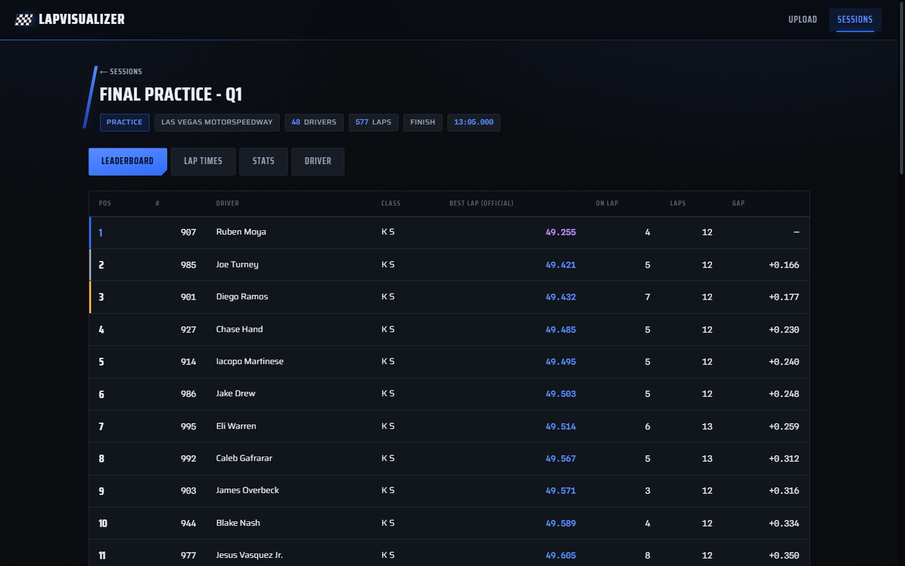
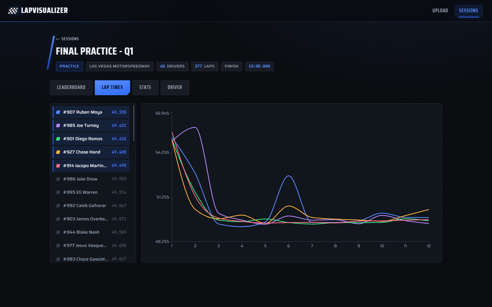
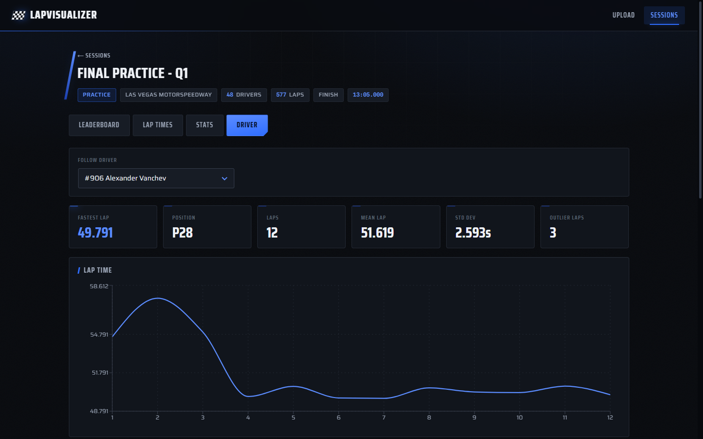
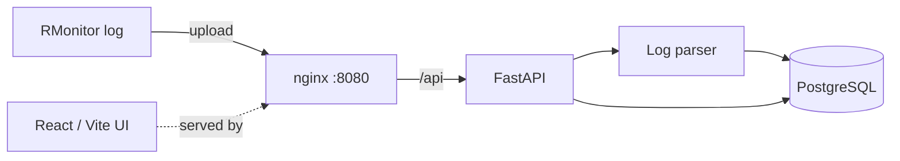

# LapVisualizer

LapVisualizer turns RMonitor / AMB timing logs (`rmon.log`, written by Orbits race timing software) into interactive race analysis. Upload a log and it stores every driver's laps, then shows a leaderboard, lap-time charts and per-driver statistics in the browser. It's meant for anyone holding a raw timing log who wants to see how a session went.


## Screenshots

Shown with a real practice session: Final Practice - Q1 at Las Vegas Motorspeedway, 48 drivers and 577 laps.


*Leaderboard ranked by each driver's official best lap.*


*Lap-by-lap times for the selected drivers.*


*One driver's stats, laps and outliers.*

## Features

- Leaderboard with official best laps, filterable by race class.
- Lap-time chart with lap-by-lap progression and side-by-side driver comparison.
- Per-driver stats and outlier detection, plus the full lap list.
- Upload with dedupe (the same session is not stored twice) and parse warnings for malformed lines in the log.
- A documented REST API with interactive OpenAPI docs at `/docs`.

## Architecture



The browser loads the React app from nginx and calls `/api` on the same origin. nginx forwards those requests to FastAPI, which parses uploaded logs and reads and writes PostgreSQL.

## Tech stack

- **Backend:** Python 3.14, FastAPI, SQLAlchemy, Alembic, Pydantic, psycopg 3, Loguru
- **Frontend:** React 19, Vite, TypeScript, React Router, Recharts
- **Database:** PostgreSQL 17
- **Tooling:** uv, Ruff, mypy (strict), pytest, Vitest, React Testing Library, ESLint
- **Infra:** Docker Compose (db, server, web), nginx, GitHub Actions

## Quick start

You need Docker with Compose.

```sh
cp .env.example .env
docker compose up --build
```

Open http://localhost:8080 and upload [`sample_data/practice_session.log`](./sample_data/practice_session.log). The API is also exposed directly at http://localhost:8000 (interactive docs at `/docs`).

`.env` is git-ignored and is the only place credentials live. The database settings have no defaults in code, so the app won't start until they're set. If port 5432 is already taken on your machine, set `POSTGRES_HOST_PORT` in `.env` to another value.

On startup the `server` container waits for PostgreSQL to be healthy, runs `alembic upgrade head`, then starts the API.

## Local development

Backend, with [uv](https://docs.astral.sh/uv/):

```sh
uv sync
cp .env.example .env
docker compose up -d db                 # PostgreSQL only
uv run alembic upgrade head
uv run uvicorn backend.app.main:app --reload
```

The API is then at http://127.0.0.1:8000. If you changed `POSTGRES_HOST_PORT`, set `POSTGRES_PORT` to the same value.

Frontend:

```sh
cd frontend
npm ci
npm run dev
```

The Vite dev server proxies `/api` to `http://localhost:8000`, so run the backend first. After changing API schemas, regenerate the TypeScript types:

```sh
npm run gen:api
```

### Configuration

All configuration is read from environment variables or `.env`: database credentials (`POSTGRES_USER` / `POSTGRES_PASSWORD` / `POSTGRES_DB`), `CORS_ORIGINS`, `MAX_UPLOAD_MB`, `LOG_LEVEL` and `ECHO_SQL`. See [`.env.example`](./.env.example) for the full list.

### Database migrations

[Alembic](https://alembic.sqlalchemy.org/) owns the schema. The app doesn't create tables on startup.

```sh
uv run alembic upgrade head                       # apply all migrations
uv run alembic revision --autogenerate -m "..."   # generate one after a model change
uv run alembic downgrade -1                       # roll back the last migration
```

After editing an ORM model, autogenerate a migration and review it before committing. `uv run alembic check` reports whether the models and the latest migration are in sync.

## API

All endpoints are served under `/api`.

| Method   | Path                           | Purpose                                    |
| -------- | ------------------------------ | ------------------------------------------ |
| `POST`   | `/sessions/upload`             | Upload and parse an RMonitor log           |
| `GET`    | `/sessions`                    | List stored sessions                       |
| `GET`    | `/sessions/{id}`               | Session detail with driver summaries       |
| `DELETE` | `/sessions/{id}`               | Delete a session                           |
| `GET`    | `/sessions/{id}/drivers`       | Drivers in a session                       |
| `GET`    | `/sessions/{id}/drivers/{reg}` | Driver detail with full lap list           |
| `GET`    | `/sessions/{id}/leaderboard`   | Best-lap ranking (`?race_class=`)          |
| `GET`    | `/sessions/{id}/progression`   | Lap-by-lap times (`?drivers=&race_class=`) |
| `GET`    | `/sessions/{id}/comparison`    | Side-by-side laps (`?drivers=11,22`)       |
| `GET`    | `/sessions/{id}/stats`         | Per-driver lap statistics                  |

The timing protocol reference is in [`docs/`](./docs).

## Testing and quality

```sh
uv run pytest               # backend tests
uv run ruff check .         # lint (use --fix to autofix)
uv run ruff format .        # format
uv run mypy backend         # strict type checking

cd frontend
npm test                    # Vitest + React Testing Library
npm run lint                # ESLint
```

Ruff is configured in [`ruff.toml`](./ruff.toml) with the full rule set enabled. On every push and pull request to `main`, GitHub Actions ([`ci.yml`](./.github/workflows/ci.yml)) runs the same checks, with `ruff format --check` in place of the formatter. CI also migrates a fresh database and runs `alembic check`, builds the frontend, and fails if the generated API types are out of date.

## Project layout

```
alembic/       database migrations
backend/       FastAPI app (routes, models, schemas, parser, services)
docs/          timing protocol reference and screenshots
frontend/      React + Vite UI, nginx config
sample_data/   a real RMonitor log to try
scripts/       helper scripts (OpenAPI dump)
tests/         backend tests
```

## License

MIT. See [LICENSE](./LICENSE).
